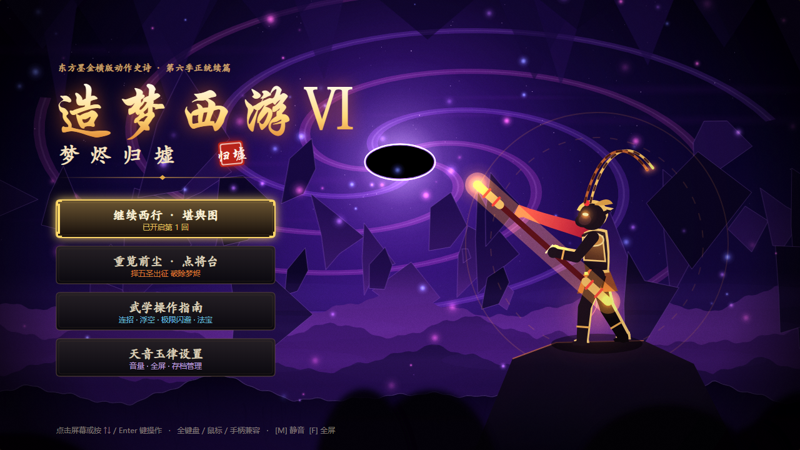
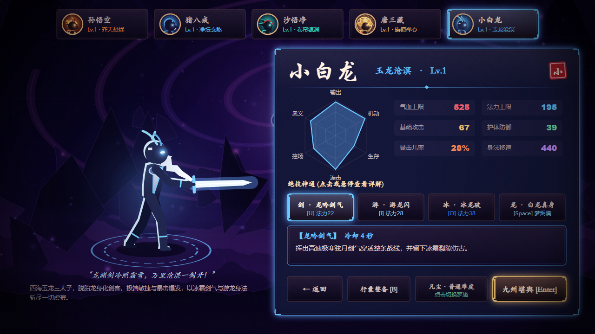
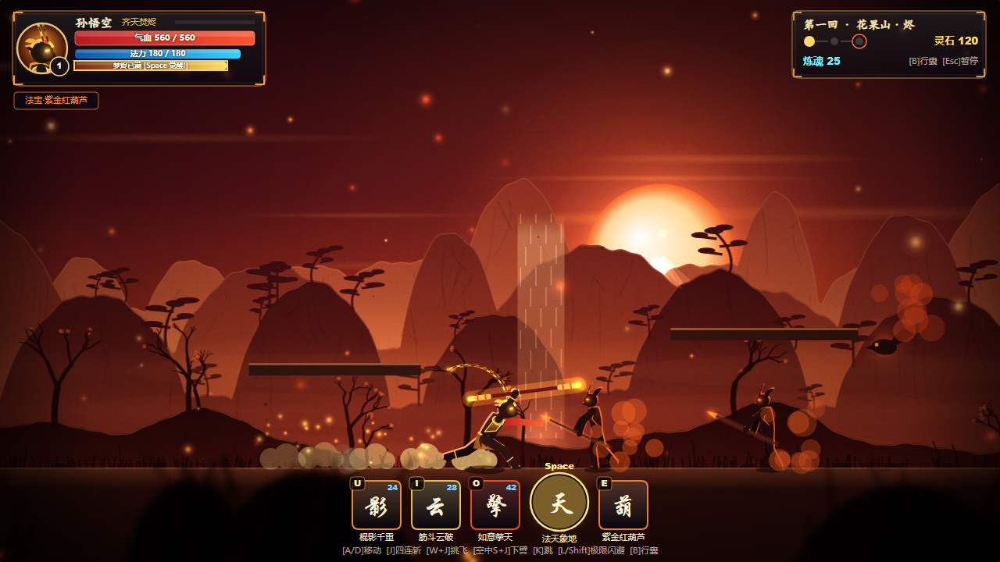
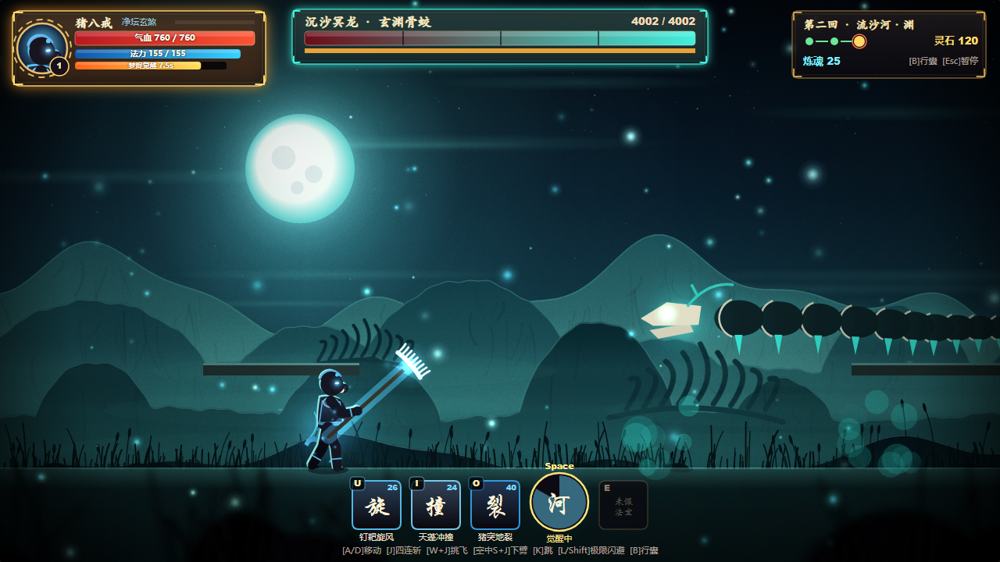
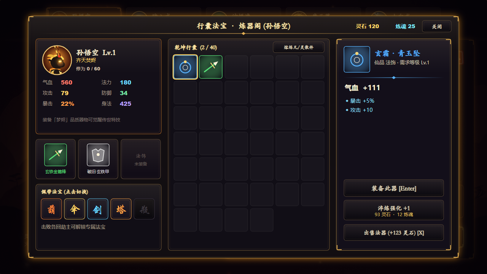
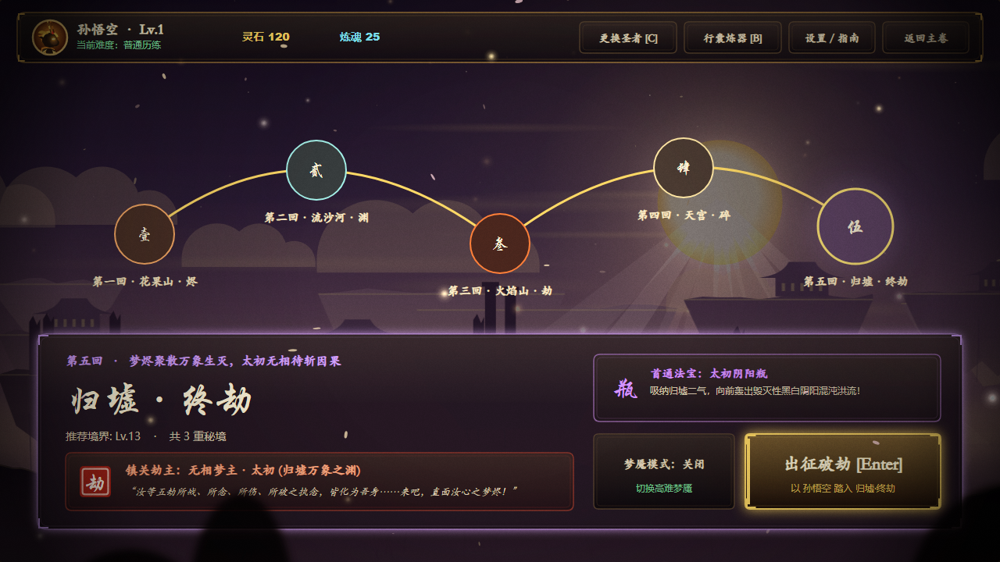

<div align="center">

# 造梦西游Ⅵ · 梦烬归墟

**东方墨金横版动作 RPG · 第六季同人续篇**

*零外部美术与音频资源 · 纯原生 HTML5 Canvas 2D 程序化建模 & WebAudio 合成配乐 · 双击 `index.html` 即刻开战*


</div>

---

## 游戏简介

西游五劫既定，三界暂归宁谧；然历代劫魔残执沉入九幽 **「归墟」**，凝作赤金 **「梦烬」**。通臂烬猿、玄渊骨蛟、魔·牛魔王、二郎显圣·堕尽皆苏醒，更有太初 **「无相梦主」** 欲以心魔吞噬取经五圣。

本作致敬经典《造梦西游 1–5》全系列玩法精髓，以 **「水墨剪影 + 霓金边缘光」** 重塑东方动作视觉表现，带来 **5 位可选主角、5 大劫关、5 名多阶段 Boss、5 大经典法宝及装备淬炼系统**。

---

## 实机画面预览

<table>
  <tr>
    <td width="50%" align="center">
      
      <br /><sub><b>主卷封面</b> · 归墟漩涡与动态齐天剪影</sub>
    </td>
    <td width="50%" align="center">
      
      <br /><sub><b>五圣点将台</b> · 动态立绘、六维雷达与绝技预览</sub>
    </td>
  </tr>
  <tr>
    <td width="50%" align="center">
      
      <br /><sub><b>花果山 · 烬</b> · 多段连招、粒子刀光与技能罗盘</sub>
    </td>
    <td width="50%" align="center">
      
      <br /><sub><b>流沙河 · 渊</b> · 18 节玄渊骨蛟多阶段首领战</sub>
    </td>
  </tr>
  <tr>
    <td width="50%" align="center">
      
      <br /><sub><b>行囊炼器阁</b> · 装备对比、+9 淬炼强化与法宝切换</sub>
    </td>
    <td width="50%" align="center">
      
      <br /><sub><b>九州堪舆图</b> · 五大章节关卡与梦魇模式切换</sub>
    </td>
  </tr>
</table>

---

## 核心特色

- **五圣齐聚 · 差异化战斗手感**
  - **孙悟空（齐天焚烬）**：金箍棒高速突进，棍影千重、筋斗云破、如意擎天，奥义 **「法天象地」**。
  - **猪八戒（净坛玄煞）**：九齿钉耙重装压制，钉耙旋风聚怪、天蓬冲撞霸体、猪突地裂，奥义 **「银河倒悬」**。
  - **沙悟净（卷帘镇渊）**：月牙宝铲攻守兼备，回旋飞铲、流沙减速法阵、念珠护盾，奥义 **「流沙天倾」**。
  - **唐三藏（旃檀禅心）**：九环锡杖中远程法术，追踪金刚咒、佛光普照回血、降魔钵镇压，奥义 **「万佛朝宗」**。
  - **小白龙（玉龙沧溟）**：玉龙剑高机动暴击，极寒剑气、游龙闪多段斩、冰龙破，奥义 **「白龙真身」**。
- **硬核动作机制**：四段普攻连招、`W+J` 升龙挑飞浮空连段、空中 `S+J` 千钧下劈、`L/Shift` 极限闪避触发时停回血与梦烬充能、首领护体韧性（Poise）破防增伤。
- **五大经典法宝**：击败各回劫主依次解锁 **紫金红葫芦、混元珍珠伞、青云冰火剑阵、玲珑七宝塔、太初阴阳瓶**。
- **五阶装备与传世特技**：涵盖 **凡 / 灵 / 仙 / 圣 / 梦烬** 五等品质、随机词缀与四大传世特技（天罚雷脉、噬魂返元、灵渊流转、梦烬灼魂），支持 `+0 → +9` 淬炼强化。
- **纯程序化视听引擎**：零图片与音频文件依赖，内置 12 自由度骨骼求解器、布料飘带、5 主题多层视差水墨背景，以及实时合成五声音阶古筝/竹笛/太鼓配乐。

---

## 快速开始

### 方式一：本地直接运行（最简单）
1. 克隆或下载本仓库源码：
   ```bash
   git clone https://github.com/MarkR630/zmxy6-mengjin-guixu.git
   ```
2. 直接使用现代浏览器（Chrome / Edge / Firefox 等）双击打开根目录下的 **`index.html`** 即可开始游戏（支持 `file://` 离线游玩，存档自动保存在浏览器 `localStorage`）。

### 方式二：本地 HTTP 服务运行
```bash
npx serve .
# 或
python -m http.server 8080
```
随后访问 `http://localhost:8080`。

### 方式三：GitHub Pages 在线游玩
仓库已内置 [GitHub Pages 自动部署工作流](.github/workflows/pages.yml)。在 GitHub 仓库的 **Settings → Pages → Source** 中选择 **GitHub Actions**，推送后即可生成在线试玩地址。

---

## 操作按键说明

| 按键 | 功能说明 |
| :--- | :--- |
| `A` / `D` 或 `←` / `→` | 左右移动与转向 |
| `K` / `W` / `↑` | 跳跃与二段轻功（`S + K` 可穿落高台） |
| `J` | 四段连击 / 空中飞燕斩 |
| `W + J` | 升龙挑飞技，震飞敌人进入浮空连击 |
| 空中 `S + J` | 千钧下劈坠击震波 |
| `L` / `Shift` | 瞬影疾闪（带无敌帧，擦弹触发 **极限闪避**） |
| `U` / `I` / `O` | 角色三大专属绝技 |
| `E` / `H` | 施展已佩带的 **先天法宝** |
| `Space` | 梦烬满格时释放 **觉醒奥义** |
| `B` / `Esc` | 随时开启乾坤行囊 / 暂停菜单 |
| `M` / `F` | 全局静音 / 切换全屏模式 |

> 同时完整兼容标准 **Gamepad 游戏手柄**（左摇杆/十字键移动，`X/A/B` 攻击/跳跃/闪避，肩键施放技能与奥义）。

---

## 项目结构

按 `index.html` 脚本依赖顺序组织：

```text
.
├── index.html                    # 主页面与 1280×720 等比自适应画布舞台
├── LICENSE                       # MIT 开源协议
├── README.md
├── .github/workflows/pages.yml   # GitHub Pages 静态部署工作流
├── docs/screenshots/             # 实机画面截图
└── js/
    ├── core.js                   # 常量、数学/缓动工具、输入轮询与 localStorage 存档
    ├── audio.js                  # WebAudio 实时音效合成与生成式五声音阶配乐
    ├── fx.js                     # 发光贴图、粒子池、武器拖尾与后处理暗角颗粒
    ├── bg.js                     # 五大主题视差山水/流沙/溶岩/天宫/归墟动态背景
    ├── rig.js                    # 骨骼求解器、程序化武器盔甲建模、物理布料与头像绘制
    ├── data.js                   # 5 名主角、5 大法宝、10 种怪物、5 回关卡与装备词缀表
    ├── skills.js                 # 20 个角色技能与 5 大法宝神通逻辑实现
    ├── entities.js               # 战斗判定引擎、玩家状态机、敌人 AI 与拾取物
    ├── bosses.js                 # 五位多阶段 Boss 行为树与专属程序化绘制
    ├── stage.js                  # 关卡房间波次调度、镜面地面、演武与奥义演出控制
    ├── ui.js                     # 墨金战斗 HUD、Boss 血条与行囊/设置/指南/暂停弹窗
    ├── scenes.js                 # 水墨转场与 Title / Prologue / Select / Map / Play / Result / Ending
    └── main.js                   # App 主状态协调器与 rAF 主循环
```

---

## 开源许可

本项目采用 [MIT License](LICENSE) 开源许可。仅供学习、技术交流与同人创作赏析使用。
